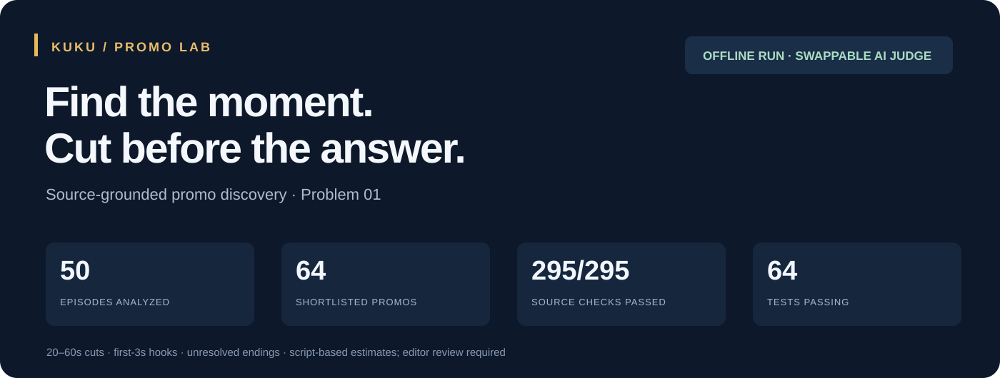
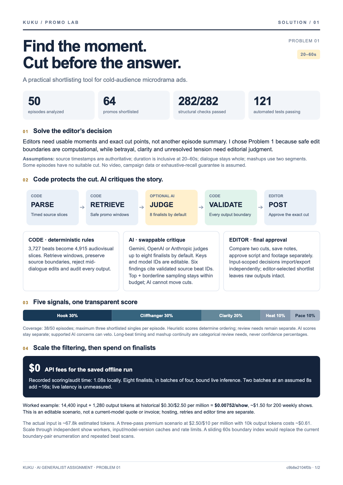
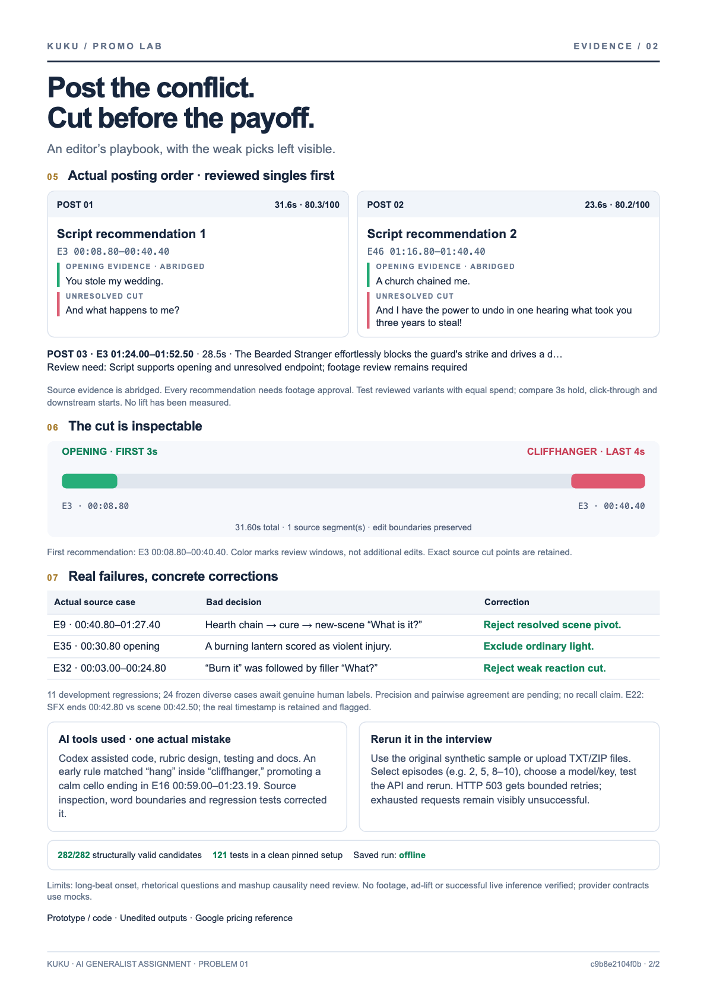
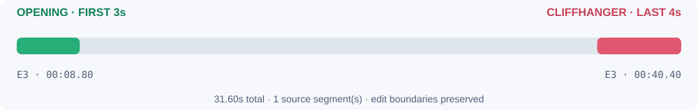
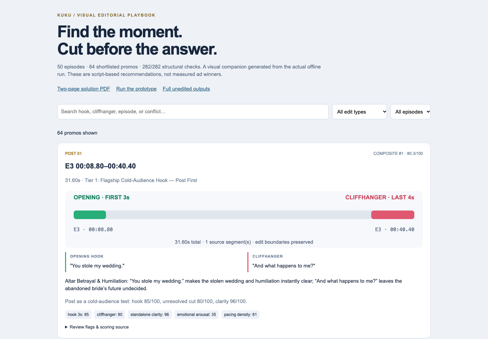
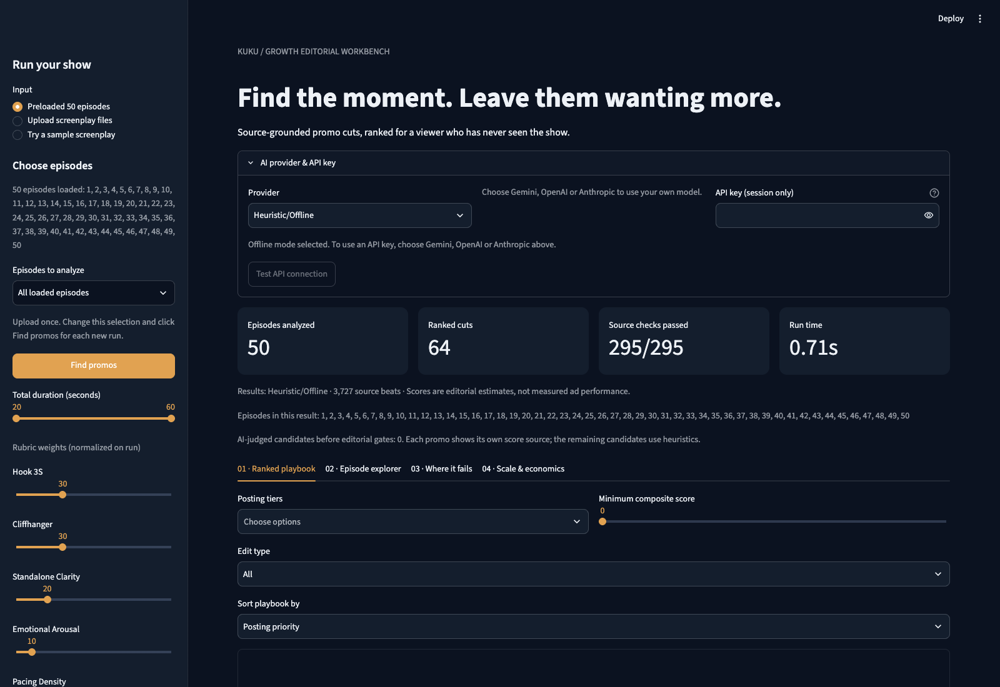

# Kuku · Promo Lab

Find **20–60 second** microdrama ads with an immediate hook, an unresolved ending and exact source cut points. A runnable Problem 1 submission with reproducible offline scoring and swappable AI critique.

**[Download the complete submission bundle](SUBMISSION_BUNDLE.zip)** — extract it to open the visual playbook locally.

**Live prototype:** https://kuku-promo-lab-shashank.streamlit.app/

**Submission steps:** [Final submission guide](FINAL_SUBMISSION_GUIDE.md) · [Verification report](deliverables/final_verification.json)

**Required deliverables:** [Two-page solution PDF](SOLUTION_DOC.pdf) · [Prototype & run steps](#run) · [Full unedited raw outputs](raw_outputs/)

**Read the evidence first.** All 50 episodes are analyzed. The saved run contains 64 shortlisted promos and 282/282 passing structural audits; scores are editorial estimates, not measured campaign performance. Optional live AI reviews only the configured finalist budget, and every score's origin is labeled.

## The solution, in two pages

<a href="SOLUTION_DOC.pdf"></a>
<a href="SOLUTION_DOC.pdf"></a>

## What the editor receives



The first recommendation is **Episode 3, 00:08.80–00:40.40 (31.6s)**. Altar Betrayal & Humiliation: “You stole my wedding.” makes the stolen wedding and humiliation instantly clear; “And what happens to me?” leaves the abandoned bride’s future undecided. Exact source cuts remain unchanged; footage review is required.



The companion [visual playbook](deliverables/visual_playbook.html) contains all 64 real promos, with search, episode/type filters, exact cuts, score breakdowns and review flags. **Open the downloaded HTML in your browser**; GitHub displays HTML source rather than running it. It works offline and makes no model API calls. The raw folder remains the complete unedited submission result.

<details>
<summary>See the historical Streamlit preview</summary>



This screenshot predates the latest editorial scoring update; use the regenerated playbook and PDF for current rankings. Upload the pack once, select episodes such as `2, 5, 8-10`, and rerun. Provider keys stay out of exports; the connection test, bounded retries and labeled fallback make live interviews inspectable.

</details>

## Run

Python 3.11+ required (3.11 tested). From this directory:

```bash
pip install -r requirements.txt
streamlit run app.py
```

Open http://localhost:8501. The dashboard loads the saved playbook immediately; choose **Try a sample screenplay** for a fresh public demo input; **Find promos** reruns with the selected input and settings. Offline mode needs no account, API key, or network. Outputs are overwritten only by the CLI, never by dashboard runs.

For isolated installation, optionally run `python -m venv .venv` and activate it first. One-command launch after Python setup (works without the confidential pack):

```bash
pip install -r requirements.txt && streamlit run app.py
```

To regenerate the full-show outputs, restore the original source folder and run `python run_pipeline.py --provider Heuristic/Offline`. For a fresh public example without the pack:

```bash
python run_pipeline.py --input examples --provider Heuristic/Offline --output /tmp/kuku-demo
```

## Submission map

| File | Purpose |
|---|---|
| `SOLUTION_DOC.pdf` | Required submission PDF, verified at two pages; Markdown and HTML sources included |
| `src/parser.py` | Episode / scene / source beat objects; simultaneous audiovisual slices |
| `src/candidate_generator.py` | Hook and endpoint retrieval; diverse continuous cuts and two-part mashups |
| `src/llm_evaluator.py` | Five-score rubric; REST adapters for Gemini, OpenAI, Anthropic; explicit offline fallback |
| `src/quality_auditor.py` | Exact source-boundary and dialogue validation; actual weak-pick examples |
| `src/economics.py` | Editable token-cost arithmetic |
| `run_pipeline.py` | Reproducible orchestration and exports |
| `app.py` | Four-tab interview prototype; TXT / ZIP uploads, model swaps, timeline, audit, economics |
| `raw_outputs/` | Unedited generated JSON, CSV, report, failure audit, SHA-256 manifest |
| `tests/` | Source-losslessness, safety, regressions, deterministic runs, provider contracts, UI smoke test |

The sample source directory is `I Married a Broken Soldier. He was a Duke/`. It is deliberately excluded from Git along with the original archives and assignment PDF; the submission PDF and deployment bundle are included. To run elsewhere, restore that directory or pass `--input /path/to/scripts`; upload your own scripts in the app. Generated outputs contain selected script quotations, not sanitized synthetic examples.

## Choose an AI judge

CLI automatically selects the first configured environment key in Gemini → OpenAI → Anthropic order. Dashboard defaults explicitly to offline. Keys entered in its password field stay in the current session and are never serialized to results.

```bash
export GEMINI_API_KEY='your-key'
python run_pipeline.py --provider Gemini --model gemini-3.5-flash-lite --judge-budget 8
# Or configure OPENAI_API_KEY / ANTHROPIC_API_KEY and select that provider.
python run_pipeline.py --provider Heuristic/Offline
python run_pipeline.py --input /path/to/new/scripts --output /tmp/promo-run --min-duration 25 --max-duration 45
```

The judge receives exact shortlisted excerpts, not all 50 full scripts. Defaults: at most 8 candidates, in batches of 4; all other candidates retain labeled heuristic scores. Malformed JSON, wrong IDs, invalid scores, authentication failures, timeouts, and retired models produce a visible warning and keep the offline evaluation. No silent claims of successful AI judgment. Provider responses cannot change edit timestamps. Temperature zero reduces variation but does not guarantee deterministic live AI output.

Gemini defaults to `gemini-3.8-flash`; legacy presets `gemini-2.5-flash` and `gemini-2.5-pro` remain selectable for accounts that still have access. Use the editable model ID if your account exposes different models. OpenAI: `gpt-4o-mini`, `gpt-4o`. Anthropic has editable current-generation presets and exact legacy Claude 3.5 IDs; the latter may be retired and error on the live API. Model availability depends on the account; use the editable model field. APIs were tested with mocked contracts, not paid live requests.

References: [Gemini pricing](https://ai.google.dev/gemini-api/docs/pricing), [OpenAI Chat Completions](https://developers.openai.com/api/reference/chat-completions/overview), [Anthropic Messages](https://platform.claude.com/docs/en/api/messages/create), [Claude lifecycle](https://platform.claude.com/docs/en/about-claude/model-deprecations).

## Reading the results

`all_episodes_promos_ranked.json` includes run telemetry, all 50 episode coverage entries, accepted `promos`, complete `rejected_candidates`, the audit, and economics assumptions. Each promo has immutable source cuts, total duration, hook / cliff evidence, scores, a composite rank, posting tier, rationale, and review flags. The CSV and Markdown report contain every shortlisted promo, not just the first ten. The manifest fingerprints the generated raw output files; presentation assets have a separate manifest.

Scoring weights: hook 30%, unresolved cut 30%, standalone clarity 20%, arousal 10%, pacing 10%. UI weights normalize automatically. Editorial gates require hook ≥55, cliff ≥55, clarity ≥55, and no detected de-escalation or music-only ending. A scene may have no qualifying promo; the explorer still lists it. Mashups contain two segments (within the allowed 2–3), total 20–60s, ordered chronologically, with shared role signals and no reused overlapping footage. They still need human continuity checks.

Hard guarantees: timestamp strings exist verbatim on the correct episode, segment duration arithmetic matches, and no edit cuts through any overlapping spoken utterance. Visual / sound tracks may legitimately span an edit; the viewer shows their complete original descriptions and clips the unified time slices to the selected interval. Hook onset within a long visual beat is uncertain and flagged. Narrative comprehension and “maximum tension” cannot be proven from lexicons alone; shortlist scores are editorial estimates, not predicted CTR.

Offline rankings and script-derived outputs are deterministic. Wall-clock telemetry naturally differs per run. Costs are estimates unless API token usage is present; a billed-cost estimate still depends on editable reference rates. The default $0.00752 hybrid scenario uses 8 × 1,800 input and 160 output tokens; $1.60 naive comparison assumes 200k script tokens, three passes, and premium rates. The actual sample contains ~67.8k estimated text tokens, so a same-model naive run costs less than that illustrative premium scenario. Hosting, retry usage, human review, and taxes are separate.

## Verify / interview demo

```bash
python -m pytest -q
python run_pipeline.py
python -m streamlit run app.py --server.headless true --server.port 8501
```

Demo sequence: inspect the top playbook → Episode 25 wound reveal → compare Episode 24's rejected slow opening in **Where it fails** → upload a TXT / ZIP → adjust duration and weights → optionally select a keyed provider → change token assumptions in the calculator. Never paste keys into screenplay files or check them into Git.

**Validation performed:** all 50 episodes parsed (3,727 beats); complete exports generated; every emitted accepted/rejected candidate checked against source; deterministic runs and mocked provider adapters tested; four dashboard tabs rendered and the run button executed through Streamlit AppTest. No footage or ad campaign was available, so visual timing and performance remain editor-review tasks.

## Streamlit Community Cloud

See [DEPLOYMENT.md](DEPLOYMENT.md) for exact account/deployment steps. Use `app.py` on branch `main`, with Python 3.11. `streamlit_deploy.zip` contains the deployable files without the confidential original screenplays or input ZIP. Extract it before uploading its contents to GitHub.

When the original folder is absent, the app loads the saved 50-episode playbook and uses saved episode metadata. To rerun or open full source timelines, upload the TXT/ZIP input and click **Find promos**. No API key is required for offline mode.

## Assignment recheck

See [REQUIREMENTS_REVIEW.md](REQUIREMENTS_REVIEW.md) for the item-by-item evidence and remaining limits. The current complete input-pack run contains **64 shortlisted promos, 218 retained rejections and 282/282 passing structural checks**. All earlier snapshots remain under `raw_outputs/history/`.

Each promo now includes a specific one-line explanation, `posting_priority`, `posting_reason` and `evaluation_source`. The dashboard defaults to posting order and also offers composite score order. Eleven deliberately selected development cases are exported by `python scripts/review_editorial_cases.py`; they are regression examples, not a measured real-world accuracy rate.

For an interview: select **Try a sample screenplay** → **Find promos** to demonstrate a fresh run without publishing the input pack. Then upload the interviewer’s TXT/ZIP files. Choose a supported provider and model, enter the key, and click **Test API connection**. The checkbox below exposes the actual provider endpoint and a placeholder-key request body. API tests send a tiny live request; selecting a provider alone does not call it. Pipeline runs show actual judged-candidate counts and per-candidate score sources.

Build a distribution with `python scripts/package_deploy.py`. It contains the original synthetic demo and the two-page solution PDF, with the confidential original pack excluded. See [INTERVIEW_GUIDE.md](INTERVIEW_GUIDE.md) for a short presentation and explanations you should understand.

Runtime versions are pinned to the clean installation used for the final audit: Streamlit 1.67.0, pandas 2.3.3 and pytest 9.2.0. The latest verification run passed 121 tests; see `deliverables/final_verification.json`. Source-dependent tests skip deliberately when the confidential pack is absent; fresh sample and dashboard tests still run.

## Free Gemini API test

Google lists `gemini-3.8-flash` with a free tier (official pricing checked 7 November 2026). See [FREE_API_TESTING.md](FREE_API_TESTING.md) for official sources and the complete test sequence. Choose Gemini, enter your own AI Studio key, then click **Prepare small Gemini test** to select the public sample and budget one. Project eligibility/quota and billing tier apply; documentation placeholders are not working API keys.

## Temporary provider outages

HTTP 500/502/503/504 responses now retry up to three HTTP attempts with exponential backoff and jitter. Long Retry-After values stop the request rather than triggering an early retry. The API test shows retry progress and a clear warning if the provider remains unavailable; it never reports success on exhaustion. Authentication, model-not-found and quota errors are not retried automatically. Judging telemetry separates logical `calls`, `http_attempts` and `retries`; usage/cost totals remain based on reported provider usage, not an invoice.

For a persistent Gemini 3.8 Flash outage, manually select the officially listed `gemini-3.5-flash-lite` preset and test it. Both have listed free tiers subject to project eligibility and quota; neither is guaranteed to be available. No automatic model or paid-provider fallback is performed.

## Upload once, select episodes

After loading the full TXT/ZIP pack, use **Choose episodes → Episodes to analyze** in the sidebar. Keep **All loaded episodes**, choose **Enter episode numbers** (for example `2, 5, 8-10`), or **Pick from list**. Click **Find promos**. Only selected episodes reach candidate generation, AI judging and exported results. Change the selection and rerun without uploading the pack again. Invalid/missing episode numbers block the run rather than being silently ignored.

An explicit manual selection permits compatible two-part mashups between any selected episode numbers, even distant ones; it does not force every selected episode into one promo. The default all-episode mode retains its nearby-episode search. Every promo still totals 20–60 seconds and passes source-boundary checks. Saved results show a stale-result notice until the selected input is rerun.

The CLI supports the same selection: `python run_pipeline.py --episodes "2,5,8-10" --output /tmp/selected-promos`. Keep the default full-pack outputs separate from these exploratory subset runs.

## Rebuild the visual deliverables

The diagrams and playbook are generated from the saved output JSON, without modifying `raw_outputs/`. The solution PDF remains exactly two pages; its source hash is printed in the footer.

```bash
python scripts/build_visual_deliverables.py
python scripts/render_visuals.py
```

The optional renderer uses local Chrome and the installed `websockets` dependency. Set `CHROME_BIN` if Chrome is not discovered. Alternatively open `SOLUTION_DOC.html` and print to A4 PDF with backgrounds enabled and browser headers/footers disabled. The supplied PDF is already rendered and checked.

`deliverables/visual_source.json` records the source snapshot. The full development narrative remains in `SOLUTION_DOC.md`; the generated HTML/PDF is its concise visual submission layout. No show footage or generated screenshots of fictional scenes are used. The prototype screenshot is a real offline browser capture.

If you regenerate raw outputs, rebuild the visual HTML and render the PDF before packaging. The package builder verifies both the source snapshot and visual-file checksums to prevent mixing old presentation assets with new results.

## Editorial review update

The results now lead with three script recommendations. Expand **AI provider & API key** to opt into live inference, and **Advanced duration, rubric & AI budget** for scoring controls. Episode selection, uploads, source timelines and original exports remain available.

Ranking uses heuristic scores only, with timing-supported recommendations before review-required candidates. AI critiques can reject a candidate or add review needs; their five scores stay separate and uncalibrated. The bounded judging sample includes top-scoring and borderline retrievals. Six structured AI findings must cite valid selected source beat IDs. Reference validation proves the cited beat exists in the relevant window, not that an AI interpretation is correct.

Under **Compare candidates & record editor decisions**, choose up to two cuts, record notes and independent script/footage decisions. Decisions persist across reruns within the session and are scoped to input content plus exact candidate cuts. Download them for persistence after closing the session; import only into the same input. Download **editor-selected shortlist** separately; original pipeline JSON remains unchanged. Script approval never implies footage approval.

`evaluation/` contains a frozen 24-case sample, blank genuine-human labeling sheets and a reproducible metric command. Current evaluation is pending human labels. The eleven existing cases are development regressions, not independent accuracy evidence. See [evaluation instructions](evaluation/README.md). Historical outputs are preserved under `raw_outputs/history/` before regeneration. Review annotations remain separate.

## Editorial audit corrections

The latest run represents **38/50 episodes**, with at most three continuous shortlisted cuts per episode. Context-aware signals exclude decorative chains, ordinary light/heat and routine kneeling; substantive questions or explicit threats/reveals replace filler endpoints. E9 00:40.80–01:27.40 is explicitly rejected for resolving the rescue before a new-scene greeting. Two development expectations (E25 “Who?” and E32 “What?”) were revised openly; the frozen evaluation and blank human labels are unchanged.

Gemini defaults to `gemini-3.5-flash-lite`. Google documents 2.0 Flash as shut down and restricts 2.5 to existing users; these remain legacy presets with warnings, not promises of API success. See [official models](https://ai.google.dev/gemini-api/docs/models) and [2.5 access note](https://ai.google.dev/gemini-api/docs/models/gemini-2.5-flash?authuser=3&hl=en).
